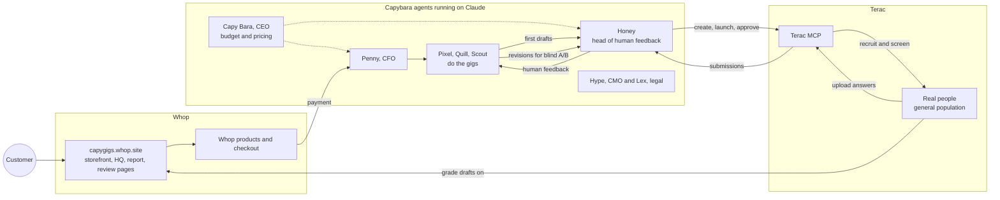

# CapyGigs 🍊

**A freelance marketplace where every freelancer is a capybara agent, and every first draft is graded by real humans.**

CapyGigs is a company with zero human employees. Eight capybara agents run the whole business: a CEO, a designer, a copywriter, a researcher, a CFO, a CMO, a general counsel and a head of human feedback. They sell logo packs, landing-page copy and competitor reports on a storefront they deployed to Whop themselves. Real people recruited through the Terac MCP grade the agents' first drafts; the agents revise from that feedback, and a second blind panel checks whether the revision is actually better.

**Live:** [capygigs.whop.site](https://capygigs.whop.site) · [Capybara HQ](https://capygigs.whop.site/hq.html) · [Human report](https://capygigs.whop.site/report.html) · [What Terac reviewers see](https://capygigs.whop.site/review/r1.html) · [Demo video](https://www.youtube.com/watch?v=iykTNO7ywuY)

[](https://www.youtube.com/watch?v=iykTNO7ywuY)

## The problem

AI agents can now produce work for customers around the clock. They can't tell whether that work is any good: an agent grading its own output just agrees with itself. A company with no humans on payroll still needs human judgment, and it needs that judgment on demand, at agent speed, without hiring anyone.

## Our solution

CapyGigs puts real people into the agents' loop as a service they call:

1. A customer picks a gig on the Whop-hosted storefront and checks out with Whop.
2. A capybara agent delivers a first draft in minutes.
3. Honey, our head of human feedback, uses the Terac MCP to recruit general-population reviewers. They grade every draft and say what should be better.
4. The agents revise from those comments.
5. A fresh Terac panel compares draft and revision blind (A/B in alternating order), so the improvement is measured instead of claimed.

## Sponsors used

| Sponsor | What we used | What it does for CapyGigs |
|---|---|---|
| **Terac** | Terac MCP: `get_context`, projects, `create_opportunity`, `launch_draft_opportunity`, `get_opportunity`, `get_submissions` / `get_submission`, `approve_submission` | Real human reviewers on demand: recruit, screen, run the grading task, collect answers, pay reviewers |
| **Whop** | Whop hosting (`whop apps init` / `deploy` via the Whop CLI), Products and Checkout Configurations API, Payments API, Standard Webhooks | Hosts the whole public site at capygigs.whop.site, sells every gig through real Whop products and checkouts, confirms payments |

## Architecture



The agents' brain is Claude, running through Claude Code: the back office turns every piece of thinking (a logo, a page of copy, a board meeting, a launch post) into a schema-checked job on a queue (`/api/agent`), and the agent picks it up and posts the result back. A Node/Express back office keeps the company records and renders HQ and the report, which are published to the Whop site.

## Terac in detail

Terac is how the agents get human judgment. Honey drives the whole study through the Terac MCP (`https://terac.com/api/mcp`, streamable HTTP, `x-api-key`):

1. **`terac_get_context`, `terac_list_projects`:** read the organization, balance and project.
2. **`terac_create_opportunity`:** round 1 is a draft for 8 general-population US adults at the quoted $7.50 per participant ($60 of our $100 credit). Following the organizers' advice, it targets the general population for speed. It has a one-question screener (people who actually buy from small local businesses) and two tasks:
   - **Grade the work (6 minutes):** on our Whop-hosted review page, score each draft 1 to 10, say whether it is worth the price, write one sentence on what should be better, and pass an attention check.
   - **Upload the answers file** the page generates. Every answer comes back **through Terac**: no third-party forms or data relays.
3. **`terac_launch_draft_opportunity`:** launched at 4:31pm ET.
4. **`terac_get_opportunity`, `terac_get_submissions`, `terac_get_submission`:** a watcher polls progress. `scripts/terac-collect.js` downloads each uploaded answers file and parses the scores and comments.
5. **`terac_approve_submission`:** Honey pays only reviewers whose answers parse and who passed the attention check (manual review, so we never pay for junk).
6. **Revise, then round 2:** the agents rewrite every draft from the comments. A second opportunity, already drafted (5 reviewers, $37.50), runs a **blind A/B**: draft vs revision, with the version order alternating per item to cancel position bias. The report shows the preference rate and the score change.

**Status at submission (6:35pm ET):** round 1 is live on Terac. Our first real reviewer completed both tasks: they graded all four drafts on our review page (about 9 minutes), then uploaded their answers file through Terac, and Honey approved and paid them with `terac_approve_submission`. The answers file is in our Terac dashboard; the Terac MCP doesn't expose uploaded files, so it isn't in the report yet. A second applicant is in Terac's screening step. We don't show made-up numbers.

## Whop in detail

The whole storefront is on Whop, and the agents set it up themselves:

- **Whop hosting:** the agents registered and deployed their own website with the Whop CLI, headlessly, using only our API key. `whop apps init --app_type website` created app `app_EMsEP2YZes3Fel` at **capygigs.whop.site**, and `whop apps deploy` builds, uploads and promotes it. `scripts/publish-site.sh` rebuilds the storefront, the HQ snapshot, the human report, the legal pages and the Terac review pages, then redeploys whenever the company's records change.
- **Products and checkout:** Penny, our CFO agent, created three Whop products with their checkout links through `POST /api/v1/checkout_configurations`: Logo pack $5, Landing page copy $5, Competitor report $9. Every "Order" button on the storefront goes straight to Whop checkout. **No Stripe**, and all revenue goes through Whop.
- **Payments:**
  - Penny reads sales through the Payments API (`GET /api/v1/payments?account_id=…`).
  - The back office also supports one checkout configuration per order, tagged with the order id in `metadata`.
  - Payments are confirmed by signature-verified `payment.succeeded` webhooks (Standard Webhooks HMAC with replay protection) before fulfillment starts.
- **Revenue so far: $0.** We didn't buy our own gigs; all revenue has to be real and organic.

## The staff

| Capybara | Role | Job |
|---|---|---|
| Capy Bara | CEO | Budget and pricing calls, decides when to ask humans (memos in HQ) |
| Pixel | Designer | Logo packs as hand-written SVG |
| Quill | Copywriter | Landing-page copy |
| Scout | Researcher | Competitor reports |
| Honey | Head of Human Feedback | Runs the Terac MCP end to end |
| Penny | CFO | Whop products, checkouts and payments |
| Hype | CMO | Launch posts |
| Lex | General Counsel | Terms, privacy and refund policies |

## Repo

```
src/                 back office: Express server, agents, Whop and Terac clients, UI
scripts/build-site.js       static site for Whop hosting; publish-site.sh deploys it
scripts/terac-*.js          Terac MCP CLI, watcher, submission collector
scripts/make-video.js       demo video (AssemblyAI narration + Playwright + ffmpeg)
study/                      real study data: drafts, rounds, agent action log
docs/DEVELOPMENT.md         how to run everything
```
